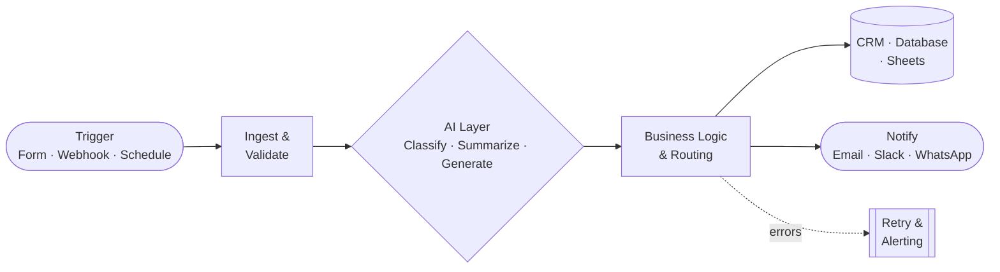

<!-- ============================================================
     RAJ MARKANA — GitHub Profile README (v2, professional)
     Repo must be named RajMarkana/RajMarkana and be public.
     ============================================================ -->

<div align="center">


<a href="https://github.com/RajMarkana">
  
</a>

<br/>


<a href="https://github.com/RajMarkana?tab=followers"></a>

<br/><br/>

<a href="http://rajmarkana.rf.gd"></a>
<a href="mailto:rtechcode101@gmail.com?subject=Project%20Inquiry"></a>
<a href="https://www.linkedin.com/in/rajmarkana"></a>

</div>

<br/>

---

## 🧭 Overview

I'm a **Full Stack and AI Automation Engineer** who ships software end to end: product thinking, architecture, build, deployment and automation. I work under **RTechCode**, taking on freelance projects alongside a full-time engineering role, so I'm used to delivering with discipline and clear communication.

<table>
<tr>
<td width="33%" valign="top">

#### 🌐 Product Engineering
Next.js, React and TypeScript front ends with Firebase or Django back ends. Fast, maintainable and built to scale.

</td>
<td width="33%" valign="top">

#### 🤖 AI & Automation
Multi-step workflows in n8n, Make and Zapier, connected to LLMs, CRMs, webhooks and custom APIs.

</td>
<td width="33%" valign="top">

#### 🚀 Micro-SaaS
From validated idea to a live, billable product, with a bias for shipping the smallest useful version first.

</td>
</tr>
</table>

---

## 🧰 Technology

<div align="center">

| Domain | Stack |
|:--|:--|
| **Frontend** |  |
| **Backend** |  |
| **Data & Cloud** |  |
| **Automation & AI** |      |
| **Tooling** |  |

</div>

<details>
<summary><b>Foundations</b> — where I started</summary>
<br/>


Android development, graphic design and C-family languages gave me strong fundamentals and a good eye for UI.

</details>

---

## 🏗️ Featured Work

<table>
<tr>
<td width="50%" valign="top">

### ⭐ BReviewAI
**AI-powered Google review collection for local businesses.**
A SaaS that makes it easy for customers to leave better reviews, and for owners to get more of them.

`Next.js` `Firebase` `AI`

</td>
<td width="50%" valign="top">

### 🔍 Winsights
**Website audit and redesign-pitch platform.**
Crawler, rule engines, PDF reports, outreach and lead pipeline in one self-hosted system.

`Python` `Flask` `Automation`

</td>
</tr>
<tr>
<td width="50%" valign="top">

### 📰 News Aggregation Platform
**Company news intelligence on n8n.**
Collects, filters and delivers relevant updates automatically, with no manual curation.

`n8n` `APIs` `Workflows`

</td>
<td width="50%" valign="top">

### 📸 PicSave
**Open-source utility project.**
One of my earlier public builds.

[View repository →](https://github.com/RajMarkana/picsave)

</td>
</tr>
</table>

<!-- Add more pinned repo cards by changing repo= below -->
<div align="center">
<a href="https://github.com/RajMarkana/picsave"></a>
</div>

---

## ⚙️ How I Build Automation



Every workflow I deliver is built with **error handling, retries, logging and clear documentation**, so it keeps running after handover.

---

## 💼 Engagements

| | Service | Typical outcome |
|:-:|:--|:--|
| 🤖 | **AI workflow automation** | Hours of manual work per week removed |
| 🌐 | **Full-stack web application** | Production app with auth, database and deployment |
| 📈 | **MVP / micro-SaaS build** | Launch-ready product in weeks, not months |
| 🔌 | **Integrations & API work** | Your tools talking to each other reliably |
| 🧪 | **Audit & consulting** | Clear roadmap for what to automate first |

<details>
<summary><b>My working process</b></summary>
<br/>

1. **Discover**: goals, constraints, success metrics
2. **Design**: architecture and a scoped plan
3. **Build**: iterative delivery with regular demos
4. **Launch**: deployment, monitoring, documentation
5. **Support**: handover and optional ongoing maintenance

</details>

<div align="center">

<a href="mailto:rtechcode101@gmail.com?subject=Project%20Inquiry"></a>

</div>

---

## 📊 Engineering Activity

<div align="center">


</div>

<div align="center">
<picture>
  <source media="(prefers-color-scheme: dark)" srcset="https://raw.githubusercontent.com/RajMarkana/RajMarkana/output/github-snake-dark.svg" />
  <source media="(prefers-color-scheme: light)" srcset="https://raw.githubusercontent.com/RajMarkana/RajMarkana/output/github-snake.svg" />
  
</picture>
</div>

<details>
<summary><b>Enable the contribution snake</b> (one-time setup)</summary>
<br/>

Create `.github/workflows/snake.yml`:

```yaml
name: Generate Snake
on:
  schedule:
    - cron: "0 0 * * *"
  workflow_dispatch:
  push:
    branches: [main]
permissions:
  contents: write
jobs:
  generate:
    runs-on: ubuntu-latest
    steps:
      - uses: Platane/snk/svg-only@v3
        with:
          github_user_name: ${{ github.repository_owner }}
          outputs: |
            dist/github-snake.svg
            dist/github-snake-dark.svg?palette=github-dark
      - uses: crazy-max/ghaction-github-pages@v3.1.0
        with:
          target_branch: output
          build_dir: dist
        env:
          GITHUB_TOKEN: ${{ secrets.GITHUB_TOKEN }}
```

Run it once from **Actions → Generate Snake → Run workflow**.

</details>

---

## 🎯 Roadmap

| Focus | Status |
|:--|:--:|
| Shipping AI-powered SaaS products | 🟢 Active |
| Client automation systems | 🟢 Active |
| Personal AI project | 🟡 In progress |
| Agentic AI & LLM workflow research | 🟡 Learning |
| Open-sourcing reusable tools | ⚪ Planned |

---

## 🤝 Contact

<div align="center">

<a href="http://rajmarkana.rf.gd"></a>
<a href="mailto:rtechcode101@gmail.com"></a>
<a href="https://www.linkedin.com/in/rajmarkana"></a>
<a href="http://www.instagram.com/rajmarkana13"></a>

<br/><br/>

<sub><i>Build systems that keep working after you stop looking at them.</i></sub>


</div>
